On November 15, 2026, I attended the **12th International Workshop on Vietnamese Language and Speech Processing (VLSP 2026)** at Ho Chi Minh City University of Technology (VNUHCM). Our independent team, **SpeechWorld**, entered two speech shared tasks and won first place in both:

- **Vietnamese Non-Verbal Text-to-Speech for Conversational Synthesis**: **1st place in Track A** (seen speakers) and **1st place in Track B** (zero-shot voice cloning). Our system fine-tuned a multilingual masked generative TTS model with a human-in-the-loop pipeline. Listeners chose every training example, and their preference pairs drove a DPO stage that we adapted to masked token prediction. ([paper, audio samples and results](/publication/2026-vlsp-vinv-tts))
- **Speech Quality Assessment**: **1st place**. We used a DSP–SSL hybrid that predicts a quality score and localises noise, distortion and unnatural pauses in time, trained with a Vietnamese degradation simulator. ([paper and results](/publication/2026-vlsp-sqa))

Thanks to my teammates Viet-Lam Phung, Minh-Khang Le, Hoang-Minh Tran, Thanh-Hau Luong, Long-Hai Tran and Minh-Toan Tran, and to the VLSP organizers.

  <figure style="margin: 0;">
    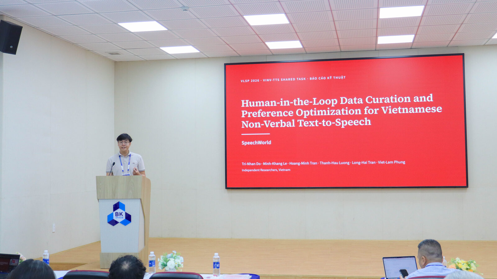
    <figcaption>Presenting our non-verbal TTS system</figcaption>
  </figure>
  <figure style="margin: 0;">
    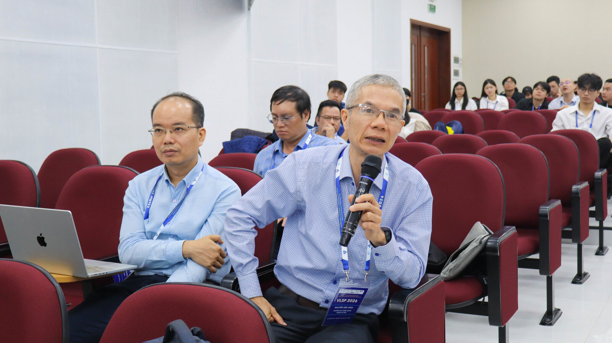
    <figcaption>Q&amp;A session</figcaption>
  </figure>
  <figure style="margin: 0;">
    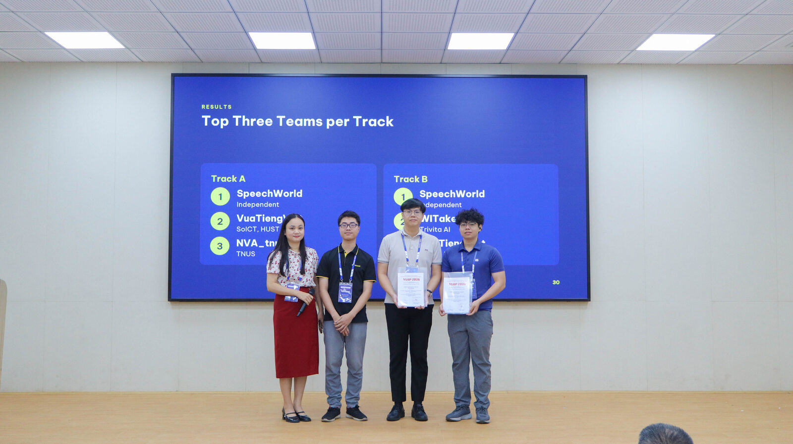
    <figcaption>ViNV-TTS awards: SpeechWorld first in Track A and Track B</figcaption>
  </figure>
  <figure style="margin: 0;">
    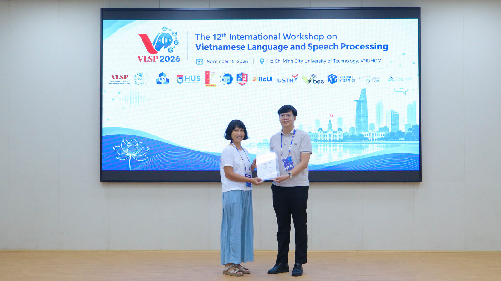
    <figcaption>Receiving the award certificate</figcaption>
  </figure>
  <figure style="margin: 0;">
    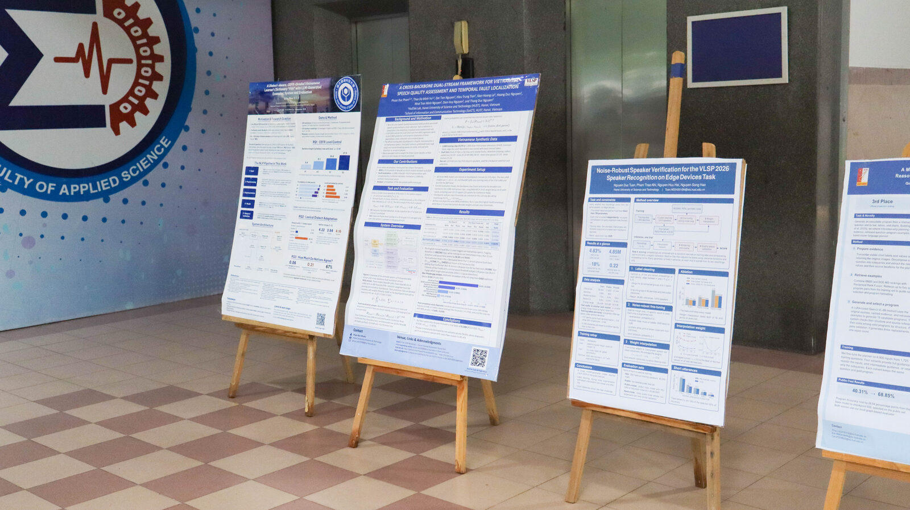
    <figcaption>Poster session</figcaption>
  </figure>
  <figure style="margin: 0;">
    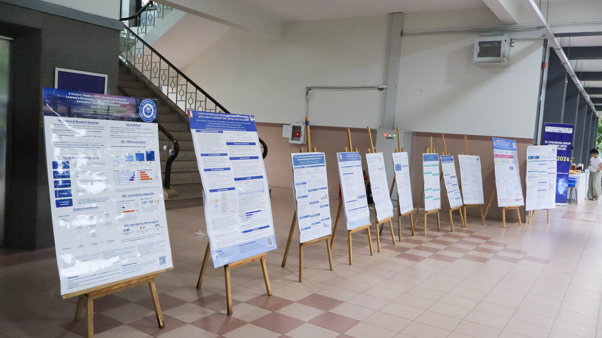
    <figcaption>Posters along the hallway</figcaption>
  </figure>
  <figure style="margin: 0;">
    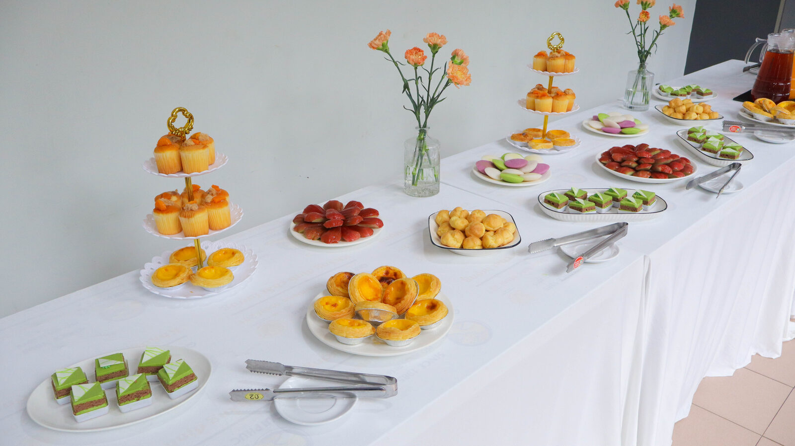
    <figcaption>Tea break</figcaption>
  </figure>
  <figure style="margin: 0;">
    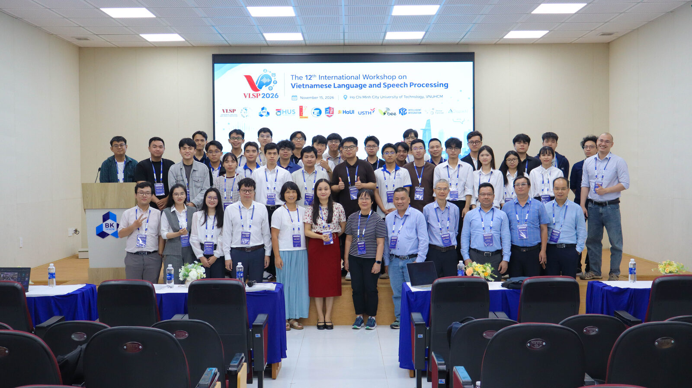
    <figcaption>VLSP 2026 group photo</figcaption>
  </figure>

## Award Certificates

  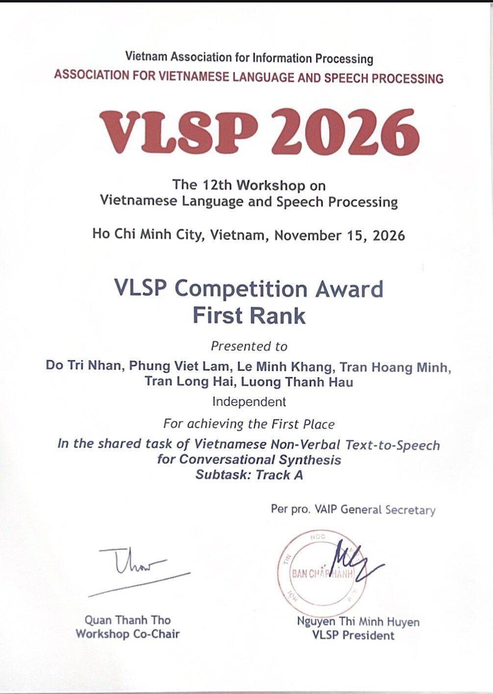
  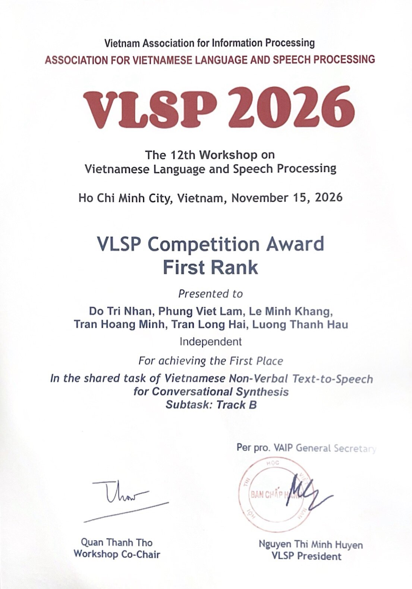
  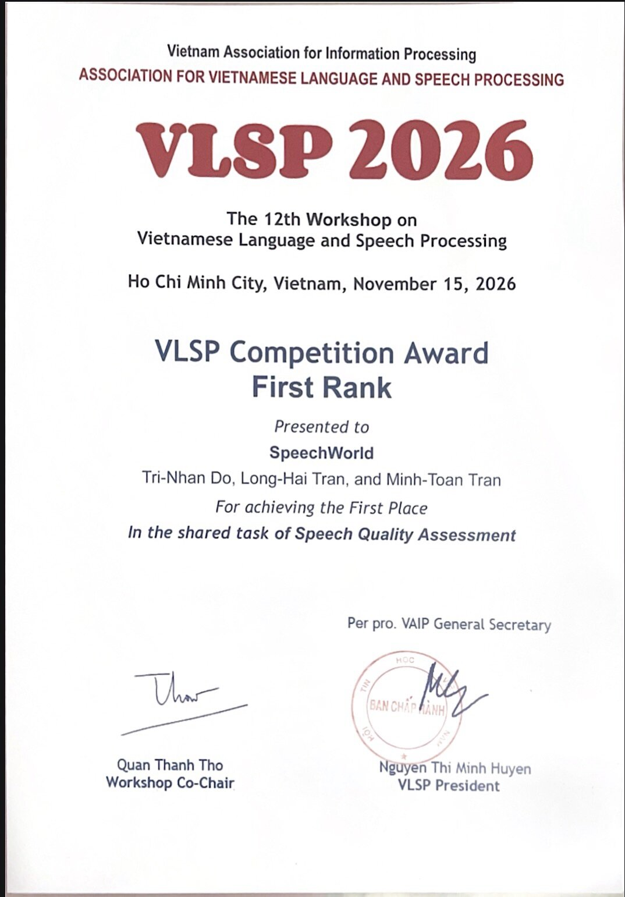

