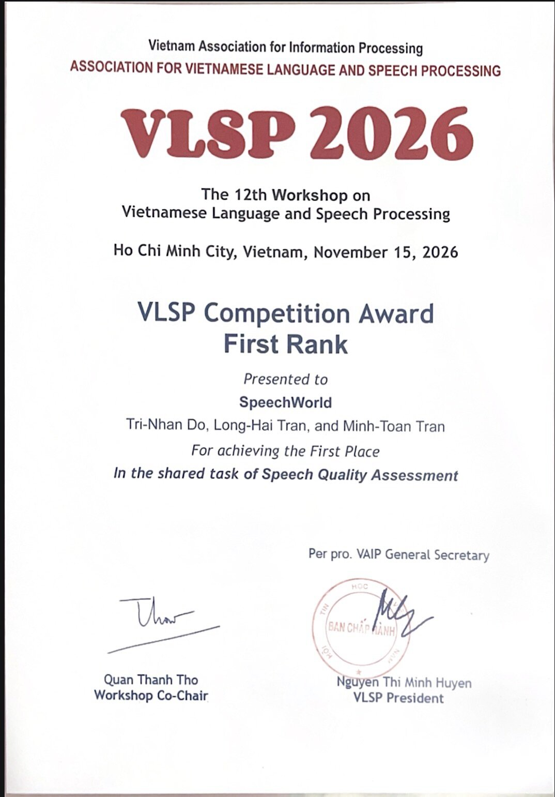
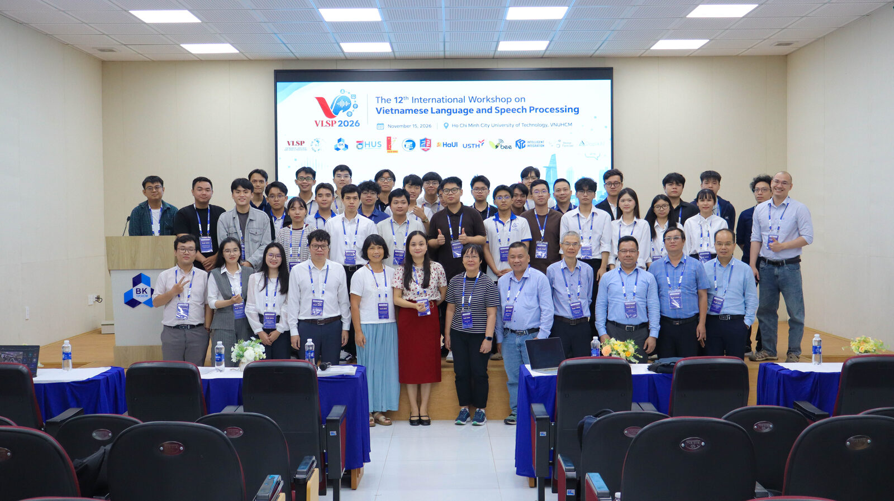

<strong>🏆 First Place</strong> in the VLSP 2026 shared task on <em>Speech Quality Assessment</em> (Team SpeechWorld).

[Download Paper](/files/vlsp-2026-sqa-paper.pdf) · Slides: [English](/files/vlsp-2026-sqa-slides-en.pdf) / [Vietnamese](/files/vlsp-2026-sqa-slides.pdf)

The VLSP 2026 Speech Quality Assessment task asks for a quality score and the time-localised detection of noise, distortion and unnatural pauses. We propose a DSP–SSL hybrid that concatenates ten signal-processing frame features with a multilingual self-supervised encoder and is trained on QualiSpeech plus a Vietnamese degradation simulator. An ensemble of four w2v-BERT 2.0 hybrids and a WavLM-based model reaches a final score of 0.617 on the private test. The released labels reveal two shifts: a domain shift in language and fault characteristics, with short and often silent distortion events, and a shift in tag distribution, with unnatural pauses in only 2.6% of the private files against 34–44% in QualiSpeech.

## Slides



## Paper

<iframe src="/files/vlsp-2026-sqa-paper.pdf" width="100%" height="3500"></iframe>

## Competition Award Certificate

VLSP Competition Award – First Rank, presented at the 12th Workshop on Vietnamese Language and Speech Processing (VLSP 2026), Ho Chi Minh City, Vietnam, November 15, 2026.

## At the VLSP 2026 Workshop

