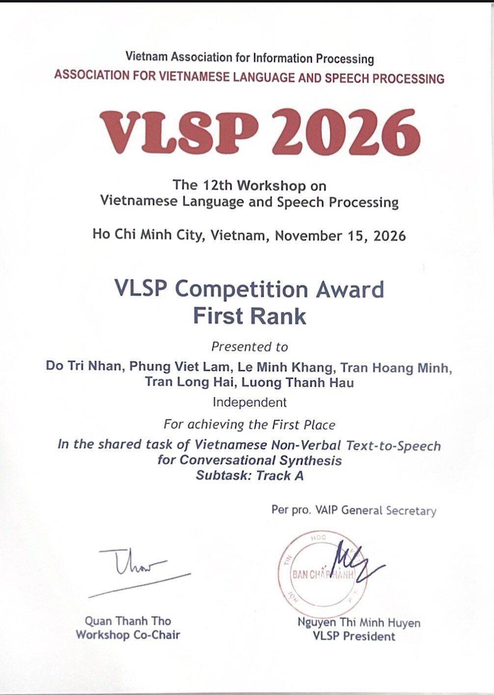
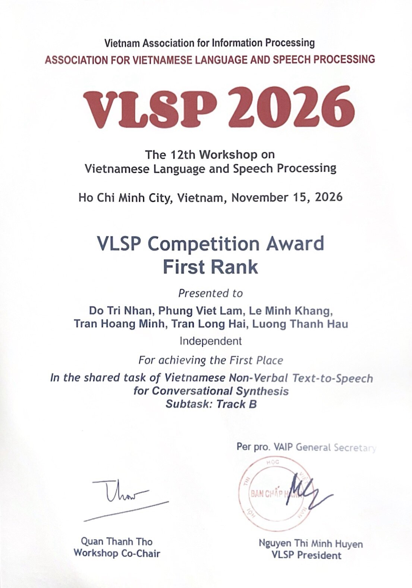
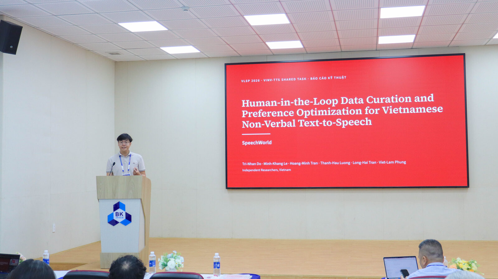
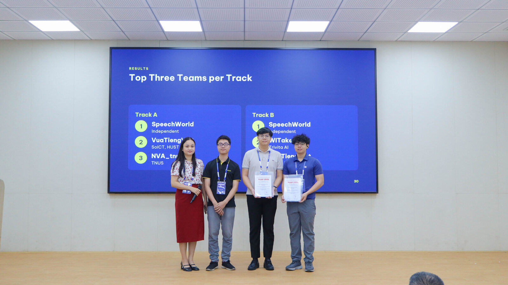
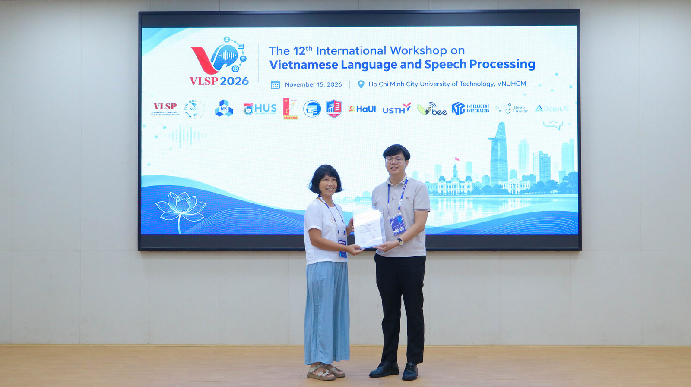
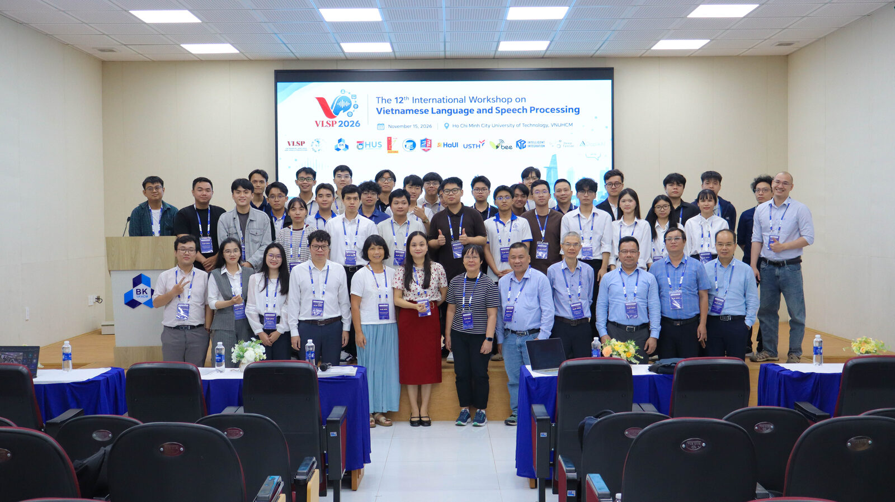

<strong>🏆 First Place in both Track A (seen speakers) and Track B (zero-shot voice cloning)</strong> of the VLSP 2026 shared task on <em>Vietnamese Non-Verbal Text-to-Speech for Conversational Synthesis</em> (Team SpeechWorld).

| Track | Final score | NV placement accuracy (NVPA) | Rank |
|---|---|---|---|
| A: speakers seen in training | 0.824 | 0.880 (66/75) | **1st** |
| B: zero-shot voice cloning | 0.839 | 0.947 (72/76) | **1st** |

[Download Paper](/files/vlsp-2026-vinv-tts-paper.pdf) · [Slides (Vietnamese)](/files/vlsp-2026-vinv-tts-slides.pdf) · [Interactive Experiment Map (Vietnamese)](/files/vlsp-2026-vinv-tts-overview/)

Few open text-to-speech (TTS) models can render non-verbal vocalizations (NVs) such as laughter, breathing, sniffing and throat clearing, and fewer still support Vietnamese. We describe our system for the VLSP 2026 ViNV-TTS shared task, which requires each tagged NV to be rendered at its intended position while the voice of the target speaker is preserved. Starting from a multilingual masked generative TTS model, we build a human-in-the-loop pipeline in which listener judgments decide all training signal. Human listening turns a small, noisily tagged corpus into clean single-NV examples, selects the best of the model’s own synthesized speech as additional training data, and supplies preference pairs for Direct Preference Optimization, which we adapt to masked token prediction by estimating sequence likelihoods from masked-token log-probabilities. The pipeline teaches the model all four NV classes from a few dozen clean examples of the rarest ones, and on the public test, preference optimization yields the largest improvement in NV placement at a small cost in speaker similarity.

## System Development

Fine-tuned from [k2-fsa/OmniVoice](https://github.com/k2-fsa/OmniVoice), a multilingual masked generative TTS model. Every training example and every preference pair was chosen by human listeners. The table shows the best checkpoint of each stage on the 330-sentence public test. The combined scores are internal proxies computed with the organizers' formula, not the official human-rated scores.

| Stage | Training signal | NVPA (proxy) | WER | SS | Proxy A | Proxy B |
|---|---|---|---|---|---|---|
| OmniVoice (base) | none | 0.136 | 5.9% | 0.756 | 0.443 | 0.451 |
| exp20 | listener-curated organizer data + 60 VieNeu-TTS throat-clearing clips | 0.685 | 3.0% | 0.743 | 0.774 | 0.726 |
| exp21 | exp20 data + 399 self-generated clips rated *Good* by 4 blind listeners | 0.742 | 3.0% | 0.748 | 0.804 | 0.764 |
| **exp22 (submitted)** | DPO on 483 human preference pairs | **0.875** | **2.7%** | 0.678 | **0.853** | **0.838** |

DPO is adapted to the masked generative model by scoring each audio with the log-probabilities of masked tokens (averaged over 4 random maskings), with the LoRA-disabled model as the reference. It gave the largest gain in non-verbal placement (laughter 0.40 → 0.84) at a small cost in speaker similarity. The [interactive experiment map](/files/vlsp-2026-vinv-tts-overview/) (Vietnamese) documents the full data flow, listening rounds, per-tag results and model architecture.

## Audio Samples

Generated by the submitted Docker image (exp22) from self-written sentences. The reference voices are two preset voices of VieNeu-TTS; no organizer audio or text is used. For each sentence the best of 4 seeds was kept (selected by the NV probe), so these are selected rather than random samples.

<strong>Reference voices:</strong> male <audio controls preload="none" src="/files/vlsp-2026-vinv-tts-overview/demo_audio/ref_male.mp3" style="vertical-align: middle; height: 32px;"></audio> · female <audio controls preload="none" src="/files/vlsp-2026-vinv-tts-overview/demo_audio/ref_female.mp3" style="vertical-align: middle; height: 32px;"></audio>

<table>
  <thead><tr><th>Tag</th><th>Text</th><th>Voice</th><th>Audio</th></tr></thead>
  <tbody>
    <tr><td>laughter</td><td>Hôm qua tôi đi chợ quên mang ví, đứng trả tiền mới biết <b>[laughter]</b> ngại không để đâu cho hết.</td><td>male</td><td><audio controls preload="none" src="/files/vlsp-2026-vinv-tts-overview/demo_audio/laughter_1.mp3"></audio></td></tr>
    <tr><td>laughter</td><td><b>[laughter]</b> Thôi chị ơi, em nói thật mà, con mèo nhà em nó tự mở được tủ lạnh luôn.</td><td>female</td><td><audio controls preload="none" src="/files/vlsp-2026-vinv-tts-overview/demo_audio/laughter_2.mp3"></audio></td></tr>
    <tr><td>laughter</td><td>Thằng bé nhà tôi bảo lớn lên muốn làm siêu nhân để khỏi phải đi học <b>[laughter]</b></td><td>male</td><td><audio controls preload="none" src="/files/vlsp-2026-vinv-tts-overview/demo_audio/laughter_3.mp3"></audio></td></tr>
    <tr><td>laughter</td><td>Lúc đầu em cứ tưởng anh ấy nói đùa <b>[laughter]</b> ai ngờ anh ấy làm thật.</td><td>female</td><td><audio controls preload="none" src="/files/vlsp-2026-vinv-tts-overview/demo_audio/laughter_4.mp3"></audio></td></tr>
    <tr><td>breathing</td><td>Leo hết chín tầng cầu thang mới tới nơi <b>[breathing]</b> thang máy lại đang sửa.</td><td>male</td><td><audio controls preload="none" src="/files/vlsp-2026-vinv-tts-overview/demo_audio/breathing_1.mp3"></audio></td></tr>
    <tr><td>breathing</td><td><b>[breathing]</b> Được rồi, mình bắt đầu lại từ đầu nhé, lần này chậm hơn một chút.</td><td>female</td><td><audio controls preload="none" src="/files/vlsp-2026-vinv-tts-overview/demo_audio/breathing_2.mp3"></audio></td></tr>
    <tr><td>breathing</td><td>Tôi vừa chạy bộ quanh hồ ba vòng xong, giờ mệt quá <b>[breathing]</b></td><td>male</td><td><audio controls preload="none" src="/files/vlsp-2026-vinv-tts-overview/demo_audio/breathing_3.mp3"></audio></td></tr>
    <tr><td>breathing</td><td>Chuyện này em nghĩ mãi rồi <b>[breathing]</b> em vẫn muốn thử thêm một lần nữa.</td><td>female</td><td><audio controls preload="none" src="/files/vlsp-2026-vinv-tts-overview/demo_audio/breathing_4.mp3"></audio></td></tr>
    <tr><td>sniff</td><td>Trời trở lạnh nên tôi bị sổ mũi mấy hôm nay <b>[sniff]</b> uống thuốc mãi chưa khỏi.</td><td>male</td><td><audio controls preload="none" src="/files/vlsp-2026-vinv-tts-overview/demo_audio/sniff_1.mp3"></audio></td></tr>
    <tr><td>sniff</td><td><b>[sniff]</b> Xin lỗi, xem phim đến đoạn cuối em không cầm được nước mắt.</td><td>female</td><td><audio controls preload="none" src="/files/vlsp-2026-vinv-tts-overview/demo_audio/sniff_2.mp3"></audio></td></tr>
    <tr><td>sniff</td><td>Mùi phở ở đầu ngõ thơm quá, sáng nào đi qua tôi cũng phải dừng lại <b>[sniff]</b></td><td>male</td><td><audio controls preload="none" src="/files/vlsp-2026-vinv-tts-overview/demo_audio/sniff_3.mp3"></audio></td></tr>
    <tr><td>sniff</td><td>Mẹ gọi điện hỏi bao giờ về quê <b>[sniff]</b> em chỉ biết nói là sắp rồi.</td><td>female</td><td><audio controls preload="none" src="/files/vlsp-2026-vinv-tts-overview/demo_audio/sniff_4.mp3"></audio></td></tr>
    <tr><td>throatclearing</td><td><b>[throatclearing]</b> Xin chào các bạn, hôm nay chúng ta sẽ nói về kế hoạch của quý tới.</td><td>male</td><td><audio controls preload="none" src="/files/vlsp-2026-vinv-tts-overview/demo_audio/throatclearing_1.mp3"></audio></td></tr>
    <tr><td>throatclearing</td><td>Theo số liệu mới nhất <b>[throatclearing]</b> doanh thu tháng này tăng khoảng mười phần trăm.</td><td>female</td><td><audio controls preload="none" src="/files/vlsp-2026-vinv-tts-overview/demo_audio/throatclearing_2.mp3"></audio></td></tr>
    <tr><td>throatclearing</td><td>Tôi xin phép phát biểu thêm một ý nhỏ <b>[throatclearing]</b> trước khi kết thúc cuộc họp.</td><td>male</td><td><audio controls preload="none" src="/files/vlsp-2026-vinv-tts-overview/demo_audio/throatclearing_3.mp3"></audio></td></tr>
    <tr><td>throatclearing</td><td>Cảm ơn mọi người đã lắng nghe, có câu hỏi gì thì cứ hỏi nhé <b>[throatclearing]</b></td><td>female</td><td><audio controls preload="none" src="/files/vlsp-2026-vinv-tts-overview/demo_audio/throatclearing_4.mp3"></audio></td></tr>
  </tbody>
</table>

## Paper

<iframe src="/files/vlsp-2026-vinv-tts-paper.pdf" width="100%" height="4000"></iframe>

## Competition Award Certificates

VLSP Competition Award – First Rank, presented at the 12th Workshop on Vietnamese Language and Speech Processing (VLSP 2026), Ho Chi Minh City, Vietnam, November 15, 2026.

  
  

## At the VLSP 2026 Workshop

  
  
  
  

